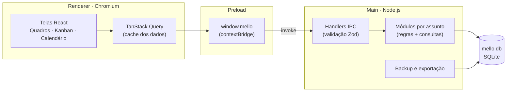
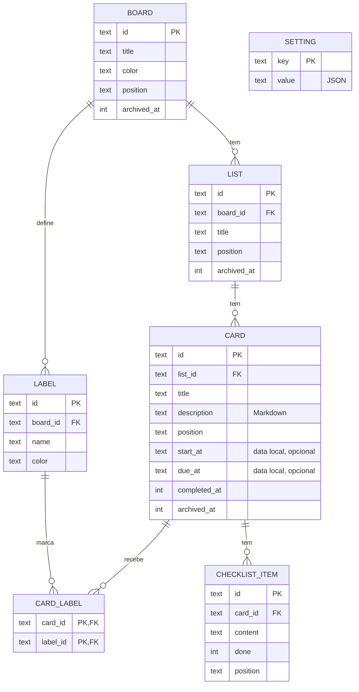
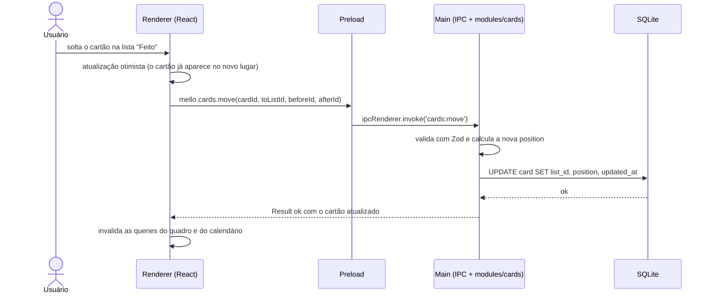

# Arquitetura do Mello

> **Status:** v0.2, versão enxuta para uso pessoal (20/10/2026). Ainda há itens a confirmar na seção [12. Decisões](#12-decisões).
> **Ver também:** [Apresentacao.txt](Apresentacao.txt) · [Definicao-da-Stack.txt](Definicao-da-Stack.txt) · [LGPD.txt](LGPD.txt) · [Pipeline.txt](Pipeline.txt)

## 1. Visão geral

O Mello é um app desktop **de uso pessoal, que roda em um único computador com Windows**. Ele não vai para a nuvem, para um site nem para uma loja de apps.

- **Um usuário, uma máquina.** Não tem servidor, login nem sincronização.
- **Os dados ficam num arquivo SQLite** dentro da pasta de dados do usuário no Windows. Nunca vão para o repositório.
- **Os mesmos dados aparecem de duas formas:** nos quadros Kanban e no calendário. Um cartão com data aparece nos dois lugares, e mudar a data em um deles muda no outro.

### 1.1 Tipo de arquitetura: monólito local

O Mello é um programa só, que guarda tudo em um arquivo só:

```
┌──────────────── Mello (um programa só) ────────────────┐
│                                                         │
│   Tela (React)  ──►  Lógica + acesso ao banco (main)    │ ──►  mello.db
│                                                         │      (um arquivo no PC)
└─────────────────────────────────────────────────────────┘
```

Como é um app pessoal e local, o Mello **não precisa** de:

- servidor ou API REST, porque a tela fala com o banco dentro do próprio app;
- login e controle de usuários;
- microsserviços, Docker ou banco em servidor (Postgres, MySQL);
- sincronização e resolução de conflitos;
- preocupação com escala, já que mesmo com milhares de cartões o SQLite responde na hora.

O que **continua importante**, mesmo sendo local:

1. **Backup.** O disco do computador é o único lugar onde os dados existem (ver [seção 9](#9-dados-do-usuário-backup-exportação-e-lgpd)).
2. **Separar a tela dos dados.** O Electron já obriga isso e é útil: dá para mexer na interface sem quebrar o banco e vice-versa.
3. **Migrações do banco.** Cada versão nova do app precisa atualizar o banco sem perder o que já foi cadastrado.
4. **A segurança básica do Electron.** Ela já vem ligada por padrão e não custa nada.

### 1.2 Princípios

1. **Simplicidade.** Nada de práticas pensadas para apps usados por muita gente. Uma camada ou ferramenta só entra se resolver um problema real deste app.
2. **Os dados do usuário vêm primeiro.** Backup antes de migrar o banco, backups automáticos fora do disco principal e exportação em formato aberto (JSON).
3. **Tipagem de ponta a ponta.** O mesmo contrato TypeScript vale do banco até a tela.

## 2. Camadas e processos

O Electron roda em processos separados. O Mello usa essa separação para manter a tela longe do banco:



| Camada | Onde roda | Responsabilidade | O que pode acessar |
|---|---|---|---|
| **Renderer** | Chromium, em sandbox | Telas, interação, estado da interface | Somente `window.mello` |
| **Preload** | Ponte isolada | Expor uma API pequena e tipada via `contextBridge` | `ipcRenderer`, sem expô-lo para a interface |
| **Main** | Node.js | Janela, ciclo de vida, banco, backup, arquivos | Tudo |
| **Shared** | Código importado pelos três | Tipos, schemas Zod, nomes dos canais IPC | Nada (código puro, sem efeitos) |

**Regra de dependência:** `main`, `preload` e `renderer` podem importar de `shared`. O `renderer` nunca importa de `main`, e `shared` não importa de ninguém.

## 3. Estrutura de pastas

```
Mello/
├── Criativo/                  # identidade visual (já existe)
├── Documentacao/              # documentação (já existe)
├── build/                     # ícone usado pelo instalador (icon.ico)
├── src/
│   ├── main/                  # processo principal (Node.js)
│   │   ├── index.ts           # ciclo de vida do app e criação da janela
│   │   ├── db/
│   │   │   ├── client.ts      # conexão + pragmas
│   │   │   ├── schema.ts      # tabelas (Drizzle)
│   │   │   └── migrations/    # SQL gerado pelo drizzle-kit
│   │   ├── modules/           # um arquivo por assunto: regras + consultas
│   │   │   ├── boards.ts
│   │   │   ├── lists.ts
│   │   │   ├── cards.ts       # inclui o checklist do cartão
│   │   │   ├── labels.ts
│   │   │   ├── calendar.ts
│   │   │   └── settings.ts
│   │   ├── ipc/               # liga cada canal a uma função de modules/
│   │   └── backup/            # backup automático, restauração e exportação
│   ├── preload/
│   │   └── index.ts           # expõe window.mello
│   ├── renderer/
│   │   ├── index.html
│   │   └── src/
│   │       ├── app/           # rotas, providers, layout
│   │       ├── features/
│   │       │   ├── boards/    # lista de quadros e Kanban
│   │       │   ├── cards/     # detalhe/edição do cartão
│   │       │   ├── calendar/  # visão de calendário
│   │       │   └── settings/  # preferências e backup
│   │       ├── components/    # componentes visuais reutilizáveis
│   │       ├── lib/           # cliente IPC tipado, utilitários de data
│   │       └── styles/        # tokens de cor, tema claro/escuro
│   └── shared/                # contratos IPC, tipos e schemas Zod
├── electron.vite.config.ts
├── electron-builder.yml
├── drizzle.config.ts
└── package.json
```

Os testes ficam ao lado do código que testam (`cards.test.ts` junto de `cards.ts`).

## 4. Modelo de dados

### 4.1 Entidades



Todas as tabelas principais também têm `created_at` e `updated_at`, que foram omitidos do diagrama.

**Convenções:**

- **IDs:** `TEXT` com UUID (`crypto.randomUUID()`), gerado no main. Não usamos autoincremento, o que facilita exportar e importar dados sem colisão.
- **Auditoria:** `created_at` e `updated_at` em `INTEGER` (epoch em milissegundos, UTC).
- **Arquivar ≠ excluir:** quadros, listas e cartões têm `archived_at` (nulo enquanto ativos), como no Trello. A exclusão definitiva usa `ON DELETE CASCADE`. Quando uma lista ou um quadro é arquivado, os cartões dele somem do Kanban e do calendário, mas continuam no banco.
- **Configurações:** a tabela `setting` guarda pares chave/valor em JSON, por exemplo tema, primeiro dia da semana, pasta de backup e quantos backups manter.

### 4.2 Ordenação (drag and drop)

**Problema:** arrastar um cartão para o meio de outros dois não deveria obrigar a renumerar a lista inteira.

**Solução:** a coluna `position` guarda chaves de *fractional indexing* (biblioteca `fractional-indexing`). A nova chave é gerada entre a do vizinho de cima e a do vizinho de baixo (`"a0"`, `"a0V"`, `"a1"`…), então só o cartão movido é atualizado. A ordem sai de um simples `ORDER BY position`.

Esse cálculo acontece **no main**, nunca na tela. O renderer informa apenas "coloque entre o cartão X e o cartão Y". O mesmo vale para listas e quadros.

### 4.3 Datas e fuso horário

Um planejador pessoal trabalha com "horário de relógio": "reunião às 14:30" quer dizer 14:30 onde a pessoa está. Por isso, `start_at` e `due_at` são guardados **em horário local, sem fuso**:

| Caso | Formato | Exemplo |
|---|---|---|
| Dia inteiro | `YYYY-MM-DD` | `2026-10-20` |
| Com horário | `YYYY-MM-DDTHH:mm` | `2026-10-20T14:30` |

- Não há conversão para UTC. Isso evita o bug clássico do prazo de dia inteiro que "pula" para o dia anterior.
- Esses textos ficam em ordem cronológica quando comparados como texto (`'2026-10-20' < '2026-10-20T14:30' < '2026-10-21'`). Assim, a consulta de um mês no calendário é só `due_at >= '2026-10-01' AND due_at < '2026-11-01'`.
- O FullCalendar entende esses formatos diretamente: sem horário, o evento vira "dia inteiro".
- Já os campos de auditoria (`created_at` etc.) ficam em UTC, porque registram *instantes* e não compromissos.

### 4.4 Configuração do SQLite

Ao abrir a conexão:

```sql
PRAGMA journal_mode = WAL;    -- gravações mais seguras e rápidas
PRAGMA foreign_keys = ON;     -- o SQLite vem com chaves estrangeiras desligadas
PRAGMA synchronous = NORMAL;  -- seguro quando combinado com WAL
```

Índices iniciais: `list(board_id, position)`, `card(list_id, position)`, `card(due_at)`, `card(start_at)`.

O arquivo fica em `app.getPath('userData')`, ou seja, `%APPDATA%\Mello\mello.db`. Essa pasta é separada da pasta onde o programa é instalado, então reinstalar ou atualizar o app não apaga os dados.

## 5. Comunicação entre processos (IPC)

### 5.1 Contrato

- Os canais seguem o padrão `entidade:ação`, por exemplo `boards:list`, `cards:move` e `calendar:range`.
- Todo canal é requisição/resposta (`invoke` / `handle`). Eventos do main para a tela só existem quando são realmente necessários, como avisar que um backup terminou.
- Os tipos e schemas Zod ficam em `src/shared/` e são a fonte única do contrato.
- O main valida toda entrada com Zod. É barato e pega bugs do próprio código antes que dados errados cheguem ao banco.
- As respostas usam um envelope `Result`, porque uma exceção perde o tipo e parte da mensagem ao atravessar o IPC.

```ts
// src/shared/ipc/cards.ts — contrato compartilhado
export const moveCardInput = z.object({
  cardId: z.uuid(),
  toListId: z.uuid(),
  beforeId: z.uuid().nullable(), // cartão que fica acima (null = topo da lista)
  afterId: z.uuid().nullable(),  // cartão que fica abaixo (null = fim da lista)
});
export type MoveCardInput = z.infer<typeof moveCardInput>;

export type Result<T> =
  | { ok: true; data: T }
  | { ok: false; error: { code: string; message: string } };

// src/preload/index.ts — expõe só o que a interface precisa
contextBridge.exposeInMainWorld('mello', {
  cards: {
    move: (input: MoveCardInput): Promise<Result<Card>> =>
      ipcRenderer.invoke('cards:move', input),
  },
});

// src/main/ipc/cards.ts — valida, chama o módulo e embrulha a resposta
import * as cards from '../modules/cards';

handle('cards:move', moveCardInput, (input) => cards.move(input));
```

`handle` é um utilitário do próprio projeto: ele valida a entrada com o schema, chama a função e transforma qualquer erro num `Result` com `ok: false`. O preload importa **apenas tipos** de `shared`, sem nenhuma biblioteca em tempo de execução, o que o mantém compatível com o modo sandbox.

### 5.2 Exemplo de ponta a ponta: mover um cartão



Se o main devolver erro, o renderer desfaz a atualização otimista e mostra um aviso.

### 5.3 Canais do MVP

| Domínio | Canais |
|---|---|
| Quadros | `boards:list`, `boards:get`, `boards:create`, `boards:update`, `boards:move`, `boards:archive`, `boards:delete` |
| Listas | `lists:create`, `lists:update`, `lists:move`, `lists:archive` |
| Cartões | `cards:get`, `cards:create`, `cards:update`, `cards:move`, `cards:archive`, `cards:delete` |
| Etiquetas | `labels:list`, `labels:create`, `labels:update`, `labels:delete`, `cards:setLabels` |
| Checklist | `checklist:add`, `checklist:update`, `checklist:move`, `checklist:remove` |
| Calendário | `calendar:range` (cartões com data num intervalo, com filtro opcional por quadros) |
| Configurações | `settings:get`, `settings:set` |
| Dados | `data:backupNow`, `data:listBackups`, `data:restore`, `data:export`, `data:openFolder`, `data:deleteAll` |

## 6. Processo main

São só duas camadas sobre o banco, numa direção só: `ipc/` → `modules/` → `db/`.

| Pasta | Faz | Não faz |
|---|---|---|
| `ipc/` | Valida a entrada com Zod, chama a função do módulo, devolve `Result` | Regras de negócio, SQL |
| `modules/` | Regras e consultas de um assunto: calcular posição, concluir cartão (`completed_at`), arquivar, buscar os cartões de um mês | Conhecer o IPC ou o Electron |
| `db/` | Conexão, pragmas, schema, migrações | — |

Cada módulo é um arquivo com funções simples (`create`, `update`, `move`…), usadas como `cards.move(...)`, sem classes nem injeção de dependência. Se um arquivo crescer demais, ele vira uma pasta, mas só quando isso acontecer. Como `modules/` não conhece o Electron, dá para testá-lo com um banco em memória.

**Inicialização:**

1. `app.whenReady()`
2. Abre o banco e aplica os pragmas.
3. Se houver migração pendente, faz backup e depois migra (em transação).
4. Faz o backup diário, se o último tiver mais de 24 h.
5. Registra os handlers IPC.
6. Cria a janela, restaurando o tamanho e a posição salvos.

**Sobre o banco síncrono:** o `better-sqlite3` bloqueia o processo main enquanto a consulta roda. No volume de um uso pessoal (milhares de cartões), cada consulta leva frações de milissegundo, então o custo é aceitável e o código fica bem mais simples.

## 7. Renderer (interface)

### 7.1 Telas e rotas

Em produção o app carrega via `file://`, onde rotas baseadas em histórico não funcionam. Por isso usamos `HashRouter`.

| Rota | Tela |
|---|---|
| `#/` | Início: lista de quadros |
| `#/boards/:boardId` | Quadro Kanban |
| `#/boards/:boardId/cards/:cardId` | Cartão aberto (modal sobre o quadro) |
| `#/calendar` | Calendário de todos os quadros, com filtro |
| `#/settings` | Configurações, backup e dados |

Como o cartão aberto faz parte da rota, ao reabrir o app ele volta para onde estava.

### 7.2 Estado

| Tipo de estado | Ferramenta | Exemplos |
|---|---|---|
| Dados do banco | TanStack Query | quadros, cartões, eventos do calendário |
| Estado de interface | Zustand ou `useState` | painel lateral aberto, filtro ativo |
| Estado na URL | React Router | quadro e cartão abertos |

O TanStack Query trata o IPC como se fosse uma API: guarda cache, recarrega depois de mutações e permite a atualização otimista do drag and drop. As chaves de query seguem a hierarquia dos dados, como `['boards']`, `['board', id]` e `['calendar', from, to, filtros]`. Quando um cartão muda, o app invalida `['board', id]` e `['calendar']`, e é isso que mantém o Kanban e o calendário sempre coerentes entre si.

### 7.3 Organização por feature

Cada pasta em `features/` contém os componentes, hooks (`useBoard`, `useMoveCard`…) e utilitários daquela área. O que é usado em mais de uma feature sobe para `components/` ou `lib/`.

### 7.4 Identidade visual

As cores vêm do ícone (`Criativo/Icon-Mello-Formatos/mello.svg`) e viram variáveis CSS:

| Token | Cor | Uso |
|---|---|---|
| `--mello-blue-900` | `#042C53` | texto forte e bordas no tema claro |
| `--mello-blue-700` | `#0C447C` | cor primária, cabeçalho |
| `--mello-blue-500` | `#378ADD` | destaques, links, foco |
| `--mello-cream` | `#F3F1EC` | fundo no tema claro |

O tema pode ser claro, escuro ou seguir o sistema.

## 8. Segurança

O Mello não carrega nada da internet. Por isso a segurança se resume ao básico que o Electron já traz ligado por padrão:

- `contextIsolation: true`, `sandbox: true` e `nodeIntegration: false` na janela (os padrões atuais do Electron).
- O preload expõe funções específicas, **nunca** o `ipcRenderer` inteiro.
- Uma Content Security Policy `default-src 'self'` impede scripts de fora do app.
- Links dentro dos cartões abrem no navegador padrão (`shell.openExternal`, só `https:`), nunca dentro do app.
- As descrições em Markdown são renderizadas **sem HTML bruto**, para que um texto colado num cartão não vire código executado.

Proteções típicas de apps distribuídos para muita gente ficam de fora, porque protegem contra ameaças que não existem aqui. São elas: Electron Fuses, assinatura de código e verificação do remetente de cada mensagem IPC.

## 9. Dados do usuário: backup, exportação e LGPD

Como nada vai para a nuvem, **o disco do computador é o único lugar onde os dados existem**. Se ele falhar e não houver uma cópia fora dele, tudo se perde. Esta é a parte mais importante da arquitetura.

- **Backup automático:** diário e também antes de cada migração. Usa a API de backup do SQLite (`db.backup()`), que é segura mesmo com o banco aberto. O app mantém os 7 mais recentes (valor configurável).
- **Pasta de backup configurável:** o padrão é `%APPDATA%\Mello\backups\`, mas o ideal é apontar para **fora do disco principal**, como um HD externo, um pendrive ou, se um dia você quiser, uma pasta sincronizada (OneDrive, Google Drive). O app só grava um arquivo nessa pasta, então isso não muda nada na arquitetura. Se a pasta não estiver disponível (HD desconectado, por exemplo), o app avisa e faz o backup na pasta padrão.
- **Backup e restauração pela interface:** criar um backup na hora, listar os existentes e restaurar um deles. Para restaurar, o app fecha o banco, guarda o arquivo atual como mais um backup, copia o escolhido e reinicia.
- **Exportação em JSON:** formato aberto e legível, para garantir a portabilidade dos dados.
- **Excluir todos os dados:** nas configurações, com confirmação.
- **Sem telemetria e sem chamadas de rede.** O app funciona sem internet.
- **Nada de dados no Git:** o `.gitignore` bloqueia `*.db`, `*.db-wal`, `*.db-shm` e `backups/`.

As práticas de LGPD ficam detalhadas em [LGPD.txt](LGPD.txt).

## 10. Build, testes e instalação

**Desenvolvimento:** `npm run dev` (electron-vite), com recarga automática da tela e reinício do main.

**Testes:**

- **Vitest nos `modules/`**, com SQLite em memória (`:memory:`) e as migrações reais. É ali que ficam as regras que podem quebrar sem ninguém perceber: posição no arraste, datas do calendário, arquivamento.
- **Opcional:** Vitest + Testing Library em componentes que tenham lógica própria.
- **Fora:** testes automatizados que abrem o app inteiro. Num app só seu, o uso do dia a dia já é o teste ponta a ponta.

> ⚠️ **Ponto de atenção:** o `better-sqlite3` é um módulo nativo compilado para o Node embutido no Electron, e esse binário não carrega no Node do sistema. Para os testes do Vitest funcionarem, é preciso recompilar o módulo para o Node antes deles ou rodar o Vitest com o binário do Electron (`ELECTRON_RUN_AS_NODE=1`). Isso deve ficar resolvido já na criação do projeto.

**Instalação no computador:**

- `npm run build:win` gera um instalador `.exe` (electron-builder, NSIS) com o ícone `build/icon.ico`.
- Para atualizar, basta gerar o instalador de novo e instalar por cima. Os dados ficam em `%APPDATA%\Mello`, separados do programa, e são preservados.
- Como o instalador não é assinado, o Windows SmartScreen avisa na primeira instalação. É só clicar em *Mais informações → Executar assim mesmo*.

**Sem CI:** o build é feito no próprio computador. Um GitHub Actions para rodar os testes a cada push pode entrar depois, se fizer falta, mas não é necessário. O passo a passo do fluxo fica em [Pipeline.txt](Pipeline.txt).

## 11. Escopo

**MVP (v1)**

- **Quadros:** criar, renomear, escolher cor, reordenar, arquivar e excluir.
- **Listas:** criar, renomear, reordenar arrastando, arquivar.
- **Cartões:** criar; editar título, descrição em Markdown, início, prazo, etiquetas e checklist; arrastar entre listas; marcar como concluído; arquivar e excluir.
- **Calendário:** visões de mês, semana e dia com os cartões datados de todos os quadros; filtro por quadro; arrastar um cartão muda a data; clicar abre o cartão.
- **Dados:** backup automático e manual, pasta de backup configurável, restauração, exportação em JSON, abrir a pasta de dados, excluir tudo.
- **Aparência:** tema claro, escuro ou do sistema.

**Depois do MVP**

- Lembretes (notificações do Windows + ícone na bandeja para o app seguir rodando)
- Tarefas recorrentes
- Busca de texto (SQLite FTS5)
- Importar quadros do Trello, que exporta em JSON
- Anexos (arquivos copiados para a pasta de dados)
- Importar a partir de uma exportação JSON

**Fora do escopo (por decisão de projeto)**

Contas e login, sincronização em nuvem ou entre computadores, colaboração com outras pessoas, app mobile ou web, versões para macOS/Linux, loja de apps e atualização automática.

## 12. Decisões

### Tomadas

| Decisão | Escolha |
|---|---|
| Tipo de arquitetura | Monólito local: um programa, um arquivo SQLite, sem servidor ([seção 1.1](#11-tipo-de-arquitetura-monólito-local)) |
| Plataforma | Somente Windows, no computador do próprio usuário |
| Organização do main | `ipc/` + `modules/`, sem camadas separadas de services e repositories |
| Testes | Vitest na lógica; sem testes automatizados do app inteiro |
| Distribuição | Instalador gerado localmente, sem CI e sem assinatura de código |

### Em aberto

| # | Pergunta | Recomendação |
|---|---|---|
| 1 | React ou Vue na interface? | **React**: maior ecossistema para o que o Mello precisa (dnd-kit, FullCalendar, TanStack Query). Se você tiver mais familiaridade com Vue, a arquitetura continua a mesma, só trocando as bibliotecas do renderer. |
| 2 | Dá para criar um item direto no calendário, sem quadro? | **Não: tudo é cartão.** Ao criar pelo calendário, o usuário escolhe quadro e lista, com o último usado já preenchido. Assim não existem dois tipos de item para manter. |
| 3 | Lembretes entram no MVP? | **Não.** Para funcionar, o app precisa continuar rodando na bandeja, o que é um trabalho à parte. Ficam para a fase 2. |

## 13. Próximos passos

1. Confirmar as decisões em aberto.
2. Detalhar as etapas do MVP em [To-do-list.txt](To-do-list.txt).
3. Criar o projeto (`electron-vite`, template `react-ts`), o `.gitignore` e o ícone em `build/`, e resolver o ponto do `better-sqlite3` nos testes.
4. Implementar uma fatia completa: schema + migração de `board` → `modules/boards.ts` → IPC → tela da lista de quadros.
5. Seguir com listas e cartões com drag and drop, depois o calendário, depois backup e exportação.
6. Gerar o primeiro instalador e começar a usar no dia a dia.
